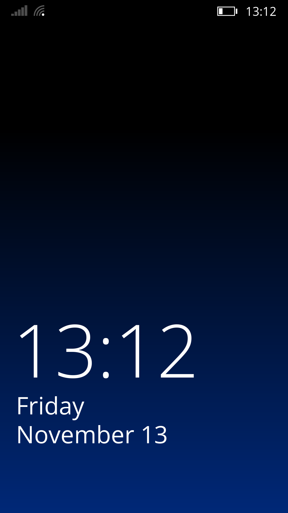
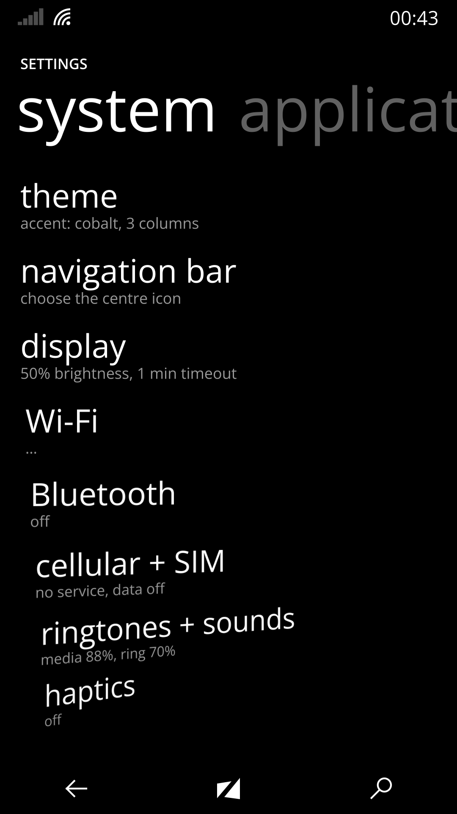
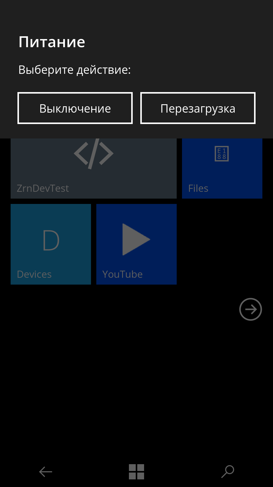
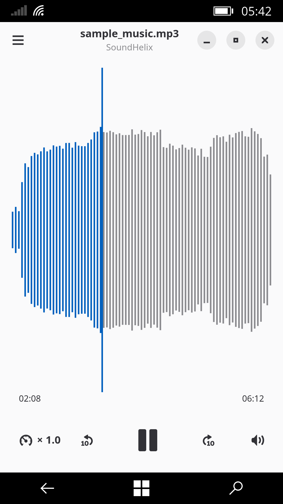

# LeEco Le 2 (s2) — postmarketOS + ztOS

[English](README_en.md) | **Русский**

---

Порт **postmarketOS (Alpine Linux)** на смартфон **LeEco Le 2** (`s2`, Qualcomm MSM8976 / Snapdragon 652) с mainline-ядром **Linux 6.18.7**, DRM/KMS, аппаратным ускорением **Adreno 510 (Freedreno)**, Wi-Fi 802.11ac, Bluetooth, зарядкой SMBCHG и мобильной оболочкой **ztMETRO** из **ztOS**.

**Ссылки:** [postmarketOS](https://postmarketos.org/) · [pmaports](https://gitlab.com/postmarketOS/pmaports) · [ztOS](https://github.com/Zerone-Laboratories/ztOS) · [zrn-sdk](https://github.com/Zerone-Laboratories/zrn-sdk)

**Состояние:** рабочий порт: система загружается автономно, интерфейс, Wi-Fi, Bluetooth (базово) и звук работают на реальном устройстве.  
**Дата последней ревизии:** 2026-11-15.  
**Баги и recovery:** [`docs/bug_report.md`](docs/bug_report.md) · **История порта:** [`docs/changelog_jt.md`](docs/changelog_jt.md).

## Скриншоты

<table>
<tr>
<td align="center"><br><b>Экран блокировки</b></td>
<td align="center"><br><b>Настройки ztMETRO</b></td>
<td align="center"><br><b>Меню питания</b></td>
</tr>
<tr>
<td align="center"><br><b>Браузер и экранная клавиатура</b></td>
<td align="center"><br><b>Angelfish</b></td>
<td align="center"><br><b>Воспроизведение звука</b></td>
</tr>
</table>

## Что работает

| Компонент | Статус | Проверено на устройстве |
|---|---|---|
| Загрузка | Работает | lk2nd → p27, mainline Linux 6.18.7 #19, rootfs на p56 |
| Дисплей и GPU | Работает | 1080×1920 @ 60 FPS, DSI BOE NT35596s, Adreno 510 / Freedreno, GLES2 |
| Тачскрин | Работает | Synaptics S2-05-01, 10 точек, кнопки Menu/Home/Back |
| Питание и зарядка | Работает | PMI8950 SMBCHG, до 1.5 А, телеметрия, фикс UVLO |
| Wi-Fi | Работает | WCN3680, 2.4/5 ГГц, WPA2/WPA3, DHCP, фикс `rp_filter` |
| Bluetooth | Работает частично | `hci0` и BlueZ 5.86 поднимаются; A2DP с реальной гарнитурой не проверен |
| Звук | Работает | ADSP/QDSP6 → Quinary MI2S → TFA9890, PipeWire, фикс `q6asm-dai` (#19) |
| Громкость | Работает | ztmetro + `ztos-sounds`, media- и ring-громкость |
| Оболочка | Работает | ztMETRO: Start, обои с параллаксом, экран блокировки, меню питания, настройки, OSK |
| Приложения | Работает | ztapps, ztsettings, ztpower, ztfiles, YouTube PWA, Instagram PWA, Angelfish, Chromium, терминал |
| USB RNDIS + SSH | Работает | `172.16.42.1`, драйвер и сертификат в репозитории |
| zram | Работает | ~50% RAM, lzo-rle, приоритет 100 |
| Захват звука | Не реализовано | Нет backend для MultiMedia2: `arecord` → `EINVAL` |
| Модем / SIM | Не реализовано | `qmic`/ModemManager не подключены |
| Камера | Не реализовано | — |
| Suspend / CPU idle | Не реализовано | Нет глубокого сна; энергопотребление в планах |

## Что ещё реализовать

- [ ] **UCM2-профиль** для `msm8976-leeco-s2` вместо `pro-audio`-workaround: штатные порты, громкость и рабочий захват микрофона.
- [ ] **Сотовый модем:** `qmic` / ModemManager, чтение SIM, мобильный интернет, SMS.
- [ ] **Камера:** драйверы сенсоров и ISP.
- [ ] **Энергопотребление:** CPUFreq `schedutil`, CPU idle, Suspend-to-RAM, гашение экрана по таймауту.
- [ ] **Датчики:** акселерометр, гироскоп, освещённость.
- [ ] **ztOS:** закрепить upstream-коммиты, собирать ztmetro/ztos-sounds из исходников, отправить патч `ztos-port/patches/ztmetro-leeco-s2.patch` upstream.
- [ ] **Релизы:** собирать `Image`, DTB и initramfs в CI, публиковать в GitHub Releases с контрольными суммами (бинарники в git не хранятся).
- [ ] **pmaports:** оформить device-пакет `device-leeco-s2` и отправить в upstream, если порт стабилизируется.

## Документация

| Документ | Содержание |
|---|---|
| [`docs/bug_report.md`](docs/bug_report.md) | Журнал BR-001…BR-035, recovery-процедуры, проверки на железе |
| [`docs/changelog_jt.md`](docs/changelog_jt.md) | История изменений порта |
| [`docs/system_analysis.md`](docs/system_analysis.md) | Анализ состояния, открытые задачи и приоритеты |
| [`docs/power_management_analysis.md`](docs/power_management_analysis.md) | Заметки по энергопотреблению и опыту других портов |

---

## 1. Цель и достигнутые результаты

Перевести смартфон LeEco Le 2 со старого Android-ядра 3.10 на современное mainline-ядро Linux 6.18.7 с полноценным **DRM/KMS**, аппаратным ускорением **Freedreno (OpenGL ES 3.1)**, встроенной поддержкой питания, беспроводной связи и мобильного интерфейса **ztOS Mobile** (`ztmetro` + `ztapps`).

### Текущий статус готовности:
- **Mainline Linux 6.18.7-msm8956+ #19:** загружается автономно с `p27`, корневая файловая система на `p56` (`/dev/mmcblk0p56`). В сборке #19 исправлен `q6asm-dai` (BR-034), из-за которого PipeWire молчал.
- **Дисплей и KMS:** 1080x1920 @ 60 FPS на DSI-панели BOE NT35596s, масштабирование UI Scale 2.0 (540x960 dp).
- **GPU:** аппаратный 3D-ускоритель Qualcomm Adreno 510 (`freedreno FD510`, Mesa 26.1.6).
- **Сенсорный ввод:** контроллер Synaptics S2-05-01 (10-точечный мультитач + сенсорные кнопки Menu/Home/Back).
- **Питание и зарядка:** PMI8950 SMBCHG (ток заряда до 1.5 А, телеметрия напряжения и емкости, спонтанные отключения UVLO устранены).
- **Беспроводная связь и сеть:** Qualcomm WCN3680 (WCNSS PIL + драйвер `wcn36xx`): Dual-Band Wi-Fi (2.4 GHz и 5 GHz 802.11ac), Bluetooth `hci0` через Qualcomm SMD. WCNSS автоматически стартует на `remoteproc1`, `wlan0` получает IP по DHCP (`udhcpc`), `hci0` поднимается без ручных команд. Интерактивное сканирование эфира, подключение к WPA2/WPA3 сетям и отображение IP-адресов USB RNDIS (`172.16.42.1`) и Wi-Fi (`192.168.x.x`) в реальном времени.
- **Звук:** Qualcomm QDSP6 / ADSP (`remoteproc0`), звуковая карта `msm8976leecos2`, маршрут `QUIN_MI2S_RX Audio Mixer MultiMedia1` → усилитель TFA9890 (GPIO 132/111). PipeWire + WirePlumber + `pipewire-pulse` запускаются от `pmos`; профиль карты `pro-audio`, sink `pro-output-0`. В ядре #19 исправлен `q6asm-dai` (BR-034): DSP-сессия корректно закрывается перед повторным `prepare` после STOP, PCM не застревает в `SETUP`. Вывод закреплён в `S16_LE` (8 ch, 48 кГц). Воспроизведение подтверждено акустически внешним микрофоном: тон 1 кГц, PCM `RUNNING`, `hw_ptr` растёт, 0 ошибок ASM, два потока подряд. Media-громкость меняется клавишами/UI через ztmetro (`ztos-sounds`, BR-035).
- **Оболочка и ввод:** Wayland-композитор `ztmetro` (ztOS) с оболочкой `ztapps`, настройками `ztsettings`, управлением питанием `ztpower` и системными звуками `ztos-sounds`. В качестве альтернативы остаётся лаунчер [`zrn-launcher`](https://github.com/Zerone-Laboratories/zrn-sdk/blob/main/examples/launcher/main.c) на `libzrnui` в стиле Windows Phone / Metro со встроенной аппаратно-ускоренной экранной клавиатурой **EN/RU OSK** в [`libzrnui`](https://github.com/Zerone-Laboratories/zrn-sdk/blob/main/libzrnui/src/osk.c).

---

## 2. Аппаратная платформа

| Параметр | Значение |
|---|---|
| **Устройство** | LeEco Le 2 (`s2`, `le_s2_ww`, X527 / X526) |
| **SoC** | Qualcomm MSM8976 / Snapdragon 652 (4x Cortex-A53 1.4 GHz + 4x Cortex-A72 1.8 GHz) |
| **GPU** | Qualcomm Adreno 510 (драйвер `freedreno FD510`, GLES 3.1 Mesa 26.1.6, 60 FPS) |
| **Память RAM** | 3 ГБ LPDDR3 (CMA выделено 96 МБ для DRM и GPU); zram swap ~1.4 ГБ (lzo-rle, приоритет 100) |
| **Флеш-память** | 32 ГБ eMMC 5.1 (режим HS200, частота 100 МГц) |
| **Дисплей** | 5.5" IPS BOE NT35596s, 1080x1920, DSI video mode, подсветка 0..4095 |
| **Тачскрин** | Synaptics S2-05-01 (RMI4 I2C, `/dev/input/event2`, 10 точек касания) |
| **Контроллер питания** | Qualcomm PMI8950 (встроенный чарджер SMBCHG 1.5A, датчик топлива FG) |
| **Wi-Fi / BT** | Qualcomm WCN3680 (Prima): 802.11a/b/g/n/ac 2.4/5 GHz + Bluetooth 4.1 LE / A2DP |
| **Загрузчик** | `lk2nd` на разделе `mmcblk0p23`, загрузочное меню — **p27**: `/mnt/system/extlinux/extlinux.conf`, ссылается на `fdt /msm8976-leeco-s2.dtb` в корне p27 (копии в `/boot` на p56 загрузчик **не читает**; для правки DTB/меню: `mount /dev/mmcblk0p27 /mnt/system`) |
| **Разметка диска** | `p27` — `/boot` (ext4, 64 МБ); `p56` — rootfs postmarketOS (ext4, ~24 ГБ) |
| **Сетевой доступ** | USB RNDIS (`172.16.42.1/24`, SSH порт 22), Wi-Fi (`wlan0` через WPA Supplicant) |
| **Аварийный вход** | Power + Vol Up → TWRP recovery; fallback-метка `s2` (legacy ядро 3.10) в lk2nd |

---

## 3. Архитектура и текущее состояние компонентов

### 3.1 Ядро и драйверы (Linux 6.18.7-msm8956+ #19)
- **DRM/KMS:** включены драйверы `CONFIG_DRM_MSM=y`, `CONFIG_DRM_MSM_MDP5=y`, `CONFIG_DRM_MSM_DSI=y`, `CONFIG_DRM_MSM_DSI_28NM_PHY=y`, встроенный драйвер панели `panel-leeco-s2-boe-nt35596s.c`. Узел `/dev/dri/card0` активен, статус `card0-DSI-1/status = connected`.
- **GPU Adreno 510:** включены узлы `&adreno_gpu` и `&gpu_iommu` в Device Tree [`msm8976-leeco-s2.dts`](kernel/msm8976-leeco-s2.dts). Установлены прошивки `a530_pm4.fw` и `a530_pfp.fw`. Выделен CMA пул 96 МБ (`cma=96M` в cmdline). Wayland и приложения работают через аппаратный GLES2 без просадок FPS.
- **eMMC контроллер:** устранен срыв прерываний hardware interrupt при интенсивной записи (BR-013). В DTS пины переведены на `sdc1_default` (16 мА), максимальная частота ограничена 100 МГц (`max-frequency = <100000000>`).
- **Swap (zram):** [`zram.start`](configs/openrc/zram.start) в `/etc/local.d` настраивает `/dev/zram0` на ~50% RAM (lzo-rle, приоритет 100) и включает swap; износ eMMC отсутствует.
- **Сенсорный ввод:** контроллер тачскрина Synaptics RMI4 I2C поддерживается ядром с `CONFIG_INPUT_EVDEV=y`. Узел `/dev/input/event2` обеспечивает работу 10-точечного мультитача и нижних сенсорных клавиш в `libinput` и `ztmetro` (либо `cage` в альтернативном режиме).
- **Контроллер зарядки PMI8950 (BR-014):**
  - Драйвер `CONFIG_CHARGER_QCOM_SMBCHG=y` встроен в ядро.
  - В DTS включены узлы `&pmi8950_smbcharger` и `&pmi8950_fg`, добавлен профиль `simple-battery` (3000 мАч, напряжение 3.4..4.4 В, ток заряда 1.5 А).
  - В [`start-sshd.sh`](configs/openrc/start-sshd.sh) выставлен лимит тока зарядки: `echo 1500000 > /sys/class/power_supply/qcom-smbchg-usb/input_current_limit`.
  - Устранено внезапное отключение телефона по Under-Voltage Lockout (UVLO).
- **Wi-Fi и Bluetooth (BR-015):**
  - В ядро встроены: `CONFIG_QCOM_WCNSS_PIL=y`, `CONFIG_QCOM_WCNSS_CTRL=y`, `CONFIG_WCN36XX=y`, `CONFIG_CFG80211=y`, `CONFIG_MAC80211=y`, `CONFIG_RFKILL=y`, `CONFIG_BT=y`, `CONFIG_BT_QCOMSMD=y`.
  - В DTS активированы узлы `&wcnss` и `&wcnss_iris` (`compatible = "qcom,wcn3680"`).
  - Прошивки `wcnss.mdt`, `wcnss.b00`..`b12` извлечены со стокового раздела `modem`.
  - Загружен аутентичный калибровочный файл `WCNSS_qcom_wlan_nv.bin` (`0xCAFEBABE`, 31 723 Б) и конфигурации `WCNSS_qcom_cfg.ini`, `WCNSS_cfg.dat`.
  - Интерфейс `wlan0` активен: подтверждено сканирование сетей 2.4 GHz и 5 GHz (802.11ac), Bluetooth `hci0` готов к работе.
  - **Передача данных через Wi-Fi (BR-030).** При двух uplink'ах (Wi-Fi + USB RNDIS) strict `rp_filter` отбрасывал ответы, приходящие на `wlan0`, если обратный маршрут для источника указывал на `usb0` (симптом: связь ассоциирована, IP есть, LAN пингуется, интернета нет). [`start-sshd.sh`](configs/openrc/start-sshd.sh) выставляет loose-режим `rp_filter = 2` для `all`, `default` и всех интерфейсов при старте, в `wifi_bringup` и в watchdog'е, а USB-маршрут по умолчанию добавляется как fallback с `metric 700` (Wi-Fi от `udhcpc` — `metric 303`). Скорость: ~5.4–6.3 МБ/с на 5 GHz.
  - **Права доступа и автозапуск:**
    - Сокет `/var/run/wpa_supplicant` переведен на группу `wheel` (`ctrl_interface_group=wheel`), чтобы непривилегированный пользователь интерфейса `pmos` мог выполнять команды сканирования `wpa_cli` без ошибки `Permission denied`.
    - Пользователю `pmos` настроен вызов `/usr/local/bin/wifi-connect` через `sudo` без пароля для настройки сетевых интерфейсов и запуска DHCP-клиента `udhcpc`.
    - В [`start-sshd.sh`](configs/openrc/start-sshd.sh) добавлен запуск **всех** offline remoteproc (ADSP и WCNSS), а не жёстко `remoteproc0`; после появления `wlan0` запускается `wpa_supplicant`, а при `wpa_state=COMPLETED` — `udhcpc`. Фоновый watchdog поддерживает интерфейс, DHCP-аренду и маршрут звука.
    - Bluetooth `hci0` появляется автоматически после старта WCNSS; `rfkill` разблокируется, `bluetoothd` BlueZ 5.86 подхватывает адаптер.
- **Звук (BR-023, BR-024, BR-026):**
  - ADSP (`remoteproc0`) поднимается из `/lib/firmware/qcom/msm8976/adsp.*`; звуковая карта — `card 0: msm8976leecos2`.
  - Для вывода на динамик включается маршрут `QUIN_MI2S_RX Audio Mixer MultiMedia1`; усилитель на GPIO 132 управляется ядром (`simple-amplifier`, consumer `enable`).
  - [`configs/system/asound.conf`](configs/system/asound.conf) назначает `card 0` устройством по умолчанию для `amixer`/`aplay`.
  - PipeWire-сессия (`dbus-daemon --session`, `pipewire`, `wireplumber`, `pipewire-pulse`) стартует из `start-sshd.sh` от пользователя `pmos`; `pmos` добавлен в группу `audio`.
  - ACP-профиль карты по умолчанию — `off`; WirePlumber-правило `51-msm8976.conf` автоматически выбирает `pro-audio`, sink `alsa_output.platform-c051000.sound.pro-output-0`. UCM-профиля для платы пока нет.
  - **Громкость (BR-035).** ztmetro меняет media-громкость через `wpctl set-volume @DEFAULT_AUDIO_SINK@` только пока `ztos-sounds` сообщает `audio-active` (активное воспроизведение). Без этого демона клавиши громкости меняли только `ring_volume`, а звук играл на неизменном уровне. `ztos-sounds` собран из `/root/ztos-ztmetro/sounds` (нужен `pulseaudio-dev`), установлен в `/usr/local/bin` и автоматически запускается ztmetro. Проверено: при играющем потоке шаг громкости меняет sink (100% → 40%) и `media_volume` в конфиге; без медиа клавиши по-прежнему управляют ringer'ом (поведение Windows Phone).
  - **Живучесть звука (BR-031, BR-034).** В конфиге WirePlumber (`configs/system/wireplumber.conf`, он же `51-msm8976.conf` на устройстве) выключены нерабочие узлы `pro-output-2` (MultiMedia3, нет свободного backend'а при занятом Quinary MI2S) и `pro-input-1` (MultiMedia2, `arecord` → `EINVAL`), а `pro-output-0` поднят по приоритету. Сторож в [`start-sshd.sh`](configs/openrc/start-sshd.sh) (раз в ~60 с) при росте `q6asm_open_write failed` перезапускает ADSP, возвращает маршрут и профиль (кулдаун 300 с), а при `auto_null` перекидывает профиль `off` → `pro-audio` (кулдаун 120 с); эти меры остаются как страховка. Окончательная причина тишины найдена на уровне ядра: `q6asm_dai_prepare()` закрывал прошлую ASM-сессию только при `state == Q6ASM_STREAM_RUNNING`, а после `TRIGGER_STOP` состояние `STOPPED` (DSP-сессия жива); повторный `open_write` возвращал `EALREADY`/`error[9]`, error-path освобождал `audio_client` и обнулял указатель, после чего `prepare` навсегда падал с `private data null or audio client freed`, и WirePlumber уходил в `Dummy Output`. Исправлено в ядре #19: сессия закрывается при `state != IDLE`, `routing_err` переводит состояние в `STOPPED`, в `open_err` client больше не освобождается; форматы вывода дополнительно ограничены `S16_LE`. Проверено микрофоном: два `pw-play` подряд, PCM `RUNNING`, доминирующая частота 1000 Гц, `q6asm_open_write failed = 0`, sink остаётся `pro-output-0`. Захват с самой платы по-прежнему не работает (нет backend'а для MultiMedia2), поэтому акустика проверяется внешним микрофоном.

---

### 3.2 Графическая среда и автозапуск OpenRC
- **OpenRC-сервисы:** службы `seatd` и `wayland` включены в уровень запуска `default`.
- **Устранение Clock Skew:** в [`start-sshd.sh`](configs/openrc/start-sshd.sh) встроена проверка системных часов: при обнаружении сброса RTC в 1970 год дата принудительно синхронизируется с актуальной и очищается устаревший кэш `/var/cache/rc/deptree`, благодаря чему все службы стартуют без пропуска. После boot сервис [`clock.start`](configs/openrc/clock.start) в фоне уточняет время по NTP (fallback — HTTP `Date`), так как RTC на s2 не пишется; без этого TLS-сертификаты (badwolf/WebKit, Chromium) не проходят проверку.
- **Композитор:** `ztmetro` (ztOS) запускается от `pmos` с аппаратным рендерером GLES2; в нём работают `ztapps`, `ztsettings`, `ztpower` и `ztos-sounds`. Выбор композитора — `COMPOSITOR` в `/etc/conf.d/wayland` (`ztmetro`, `labwc`, `cage`, `weston`).
- **Сессионная шина и звук:** [`start-sshd.sh`](configs/openrc/start-sshd.sh) создаёт `/run/user/1000`, поднимает пользовательский `dbus-daemon`, PipeWire, WirePlumber и `pipewire-pulse`; [`wayland.init`](configs/openrc/wayland.init) передаёт приложениям `DBUS_SESSION_BUS_ADDRESS=unix:path=/run/user/1000/bus`.
- **Сессионный скрипт (режим `cage`):** [`/usr/local/bin/zrn-session`](scripts/zrn-session) устанавливает масштаб UI Scale 2.0 (`wlr-randr --output DSI-1 --scale 2.0`) и поддерживает постоянный цикл работы мобильного лаунчера.

---

### 3.3 Альтернативный лаунчер zrn-launcher (zrn-sdk)

> На устройстве по умолчанию работает `COMPOSITOR="ztmetro"` (ztOS: `ztapps`, `ztsettings`, `ztpower`, `ztos-sounds`). Раздел ниже описывает альтернативный лаунчер `zrn-launcher` на `libzrnui`.

Приложение [`zrn-sdk/examples/launcher/main.c`](https://github.com/Zerone-Laboratories/zrn-sdk/blob/main/examples/launcher/main.c) разработано на библиотеке **libzrnui** в мобильной концепции Windows Phone / Metro UI:
- **Вкладка «Программы»:**
  - Системные настройки (яркость экрана, темная/светлая тема, выбор акцентного цвета).
  - Терминал / Консоль (интерактивный шелл прямо в UI с выводом stdout и быстрыми кнопками `free`, `ip a`, `uptime`, `dmesg`).
  - Мобильный терминал Foot (CLI-сессия в Wayland).
  - Демо-приложение на Python 3.14 / zrnui.
  - Демонстрация интерактивных виджетов (счетчик тапов, текстовые поля с клавиатурой).
  - Монитор системных ресурсов.
  - Быстрый регулятор яркости подсветки.
- **Вкладка «Устройство»:**
  - Информация об аппаратной платформе (MSM8976, Adreno 510, Linux 6.18.7, Alpine 3.24).
  - Статус питания: процент заряда, напряжение на банке в реальном времени, чистый ток зарядки/разрядки, контроллер PMI8950.
  - Сетевые подключения: динамический статус Wi-Fi (`SSID` и `IP-адрес`), USB Сеть RNDIS (`172.16.42.1 (SSH)`) и статус Bluetooth (`hci0`).
  - Кнопка безопасной перезагрузки устройства.
- **Подстраница «Wi-Fi сети»:**
  - Отображение MAC-адреса, текущего состояния (`COMPLETED`, `INACTIVE`) и сетевых адресов: Wi-Fi IP (DHCP) и USB RNDIS (`172.16.42.1`).
  - Кнопка активного сканирования эфира (автоматический опрос каналов 2.4/5 GHz с обновлением списка сетей).
  - Динамический список обнаруженных сетей с уровнями сигнала (dBm) и диапазонами (2.4 GHz / 5 GHz).
  - Выбор сети в один тап, ввод пароля через встроенную экранную клавиатуру.
  - Автоматическое подключение и получение сетевого адреса по DHCP (`udhcpc`).
- **Виртуальная экранная клавиатура (libzrnui OSK, BR-016):**
  - Полные раскладки: Английская (QWERTY), Русская (ЙЦУКЕН), Цифры и знаки (?123 / ABC).
  - Переключение раскладок в один тап (`EN` / `RU`, `?123` / `ABC`).
  - Быстрая полоса знаков препинания (`, . ! ? - @ : / _`) и кнопка сворачивания `[✕]`.
  - Автоматический вызов при фокусировке поля ввода и подъем содержимого страницы (auto-scroll lift).
  - Полный сенсорный ввод на русском и английском языках с аппаратным GLES2 рендерингом на 60 FPS.
- **Экран блокировки и режим сна (Lockscreen & Sleep Mode, BR-017):**
  - **Экран блокировки:** крупные цифровые часы (48pt Metro font), текущая дата на русском языке, сводка состояния устройства (заряд батареи, напряжение, активная сеть Wi-Fi/USB), кнопка `🔓 Разблокировать экран` и кнопка `🌙 Выключить экран (Сон)`.
  - **Защита от обхода:** аппаратная и сенсорная кнопка Back блокируется на экране блокировки (`zui_back` игнорирует события при активном замке).
  - **Энергосберегающий режим сна (Display Sleep):**
    - Выключение подсветки дисплея (`brightness = 0`).
    - Переключение регулятора частот CPU в режим `powersave` (400 MHz).
    - Остановка цикла отрисовки GLES2 в `libzrnui` (0% нагрузки на Adreno 510 GPU и CPU).
    - Автоматическое сворачивание виртуальной клавиатуры.
  - **Способы пробуждения и блокировки:**
    - **Физическая кнопка питания (Power button):** чтение `/dev/input/event0` (`pm8941_pwrkey`) переключает сон/бодрствование и блокирует устройство.
    - **Tap-to-wake:** прикосновение к сенсорному экрану (`/dev/input/event2`) в спящем режиме мгновенно включает подсветку и возвращает на экран блокировки без ложных нажатий.
    - **Таймер бездействия:** автоматический переход в режим сна и блокировка после 60 секунд отсутствия касаний.
    - **Кнопка в интерфейсе:** «🔒 Заблокировать экран (Сон)» на вкладке «Программы».
    - **Внешнее управление через сигналы (`signalfd`):** `SIGHUP` (кнопка питания), `SIGUSR1` (блокировка и сон), `SIGUSR2` (пробуждение и разблокировка).
- **Регулировка громкости аппаратными и экранными кнопками (Volume Control, BR-018):**
  - **Аппаратные клавиши громкости:**
    - Кнопка **Volume Down** (`KEY_VOLUMEDOWN` 114): чтение `/dev/input/event1` (`pm8941_resin`) через `zui_watch_fd()`, шаг -5%.
    - Кнопка **Volume Up** (`KEY_VOLUMEUP` 115): чтение `/dev/input/event3` (`gpio-keys`) через `zui_watch_fd()`, шаг +5%.
    - Поддержка зажатия клавиши (key repeat, `ev.value == 2`) для непрерывного изменения уровня.
    - Аппаратная обработка через Wayland keyboard listener (`k_key` в `wl.c`) с защитой от дребезга (debounce 30 мс).
  - **Визуальный HUD (On-Screen Toast):**
    - Всплывающее графическое уведомление при любом изменении с динамической иконкой динамика: `🔇 Без звука`, `🔈 15%`, `🔉 45%`, `🔊 75%`, `🔊 100% (макс.)`.
    - Тактильный виброотклик (`haptic tap`).
  - **Элементы управления в UI:**
    - Главный экран («Программы»): блок «Быстрая громкость» со слайдером 0..100% и кнопками `🔉 Тише (-5%)`, `🔇 Mute`, `🔊 Громче (+5%)`.
    - Раздел «Настройки»: детальный блок «Звук и громкость» со слайдером, тумблером «Без звука (Mute)» и быстрыми пресетами `25%`, `50%`, `75%`, `100%`.
  - **Системная интеграция и сохранение:**
    - Автоматическая передача значений в системные микшеры `amixer`, `wpctl` (PipeWire) и `pactl` (PulseAudio).
    - Сохранение уровня громкости и состояния Mute в файл `~/.config/zrn-volume` с восстановлением при старте.
    - Управляющий FIFO-канал `/tmp/zrn-ctl` для скриптов и SSH (`vol +5`, `vol -5`, `vol <0-100>`, `mute`, `page <name>`).
- **Веб-браузер Chromium и аудиоподсистема PipeWire (Web & Audio, BR-019):**
  - **Браузер:** установлен полноценный современный браузер `chromium` (версия 156.0.8078.79) с набором шрифтов Noto, DejaVu и OpenSans.
  - **Нативный Wayland:** запуск с параметрами `--ozone-platform=wayland`, масштабированием под экран `--force-device-scale-factor=2.0` и автоматическим разворотом на полный экран `--start-maximized` (разрешение 1080x1920).
  - **Аппаратное 3D-ускорение:** рендеринг через GPU Adreno 510 (`freedreno`) по EGL/GLES2 без задержек интерфейса.
  - **Аудиоподсистема PipeWire 1.6.8:** автоматический подъем аудиосервера PipeWire, сессионного менеджера WirePlumber и моста эмуляции PulseAudio (`pipewire-pulse`).
  - **Стриминг звука:** сквозной тракт Chromium → PipeWire проверен: sink `pro-output-0` (профиль `pro-audio`), PCM `RUNNING`, `hw_ptr` растёт, задержек и выпадений нет; громкость синхронизирована с лаунчером (`wpctl`). Акустически (внешний микрофон) подтверждён тон 1 кГц после исправления `q6asm-dai` в ядре #19 (BR-034).
  - **YouTube & Instagram PWA (Автономные веб-приложения без рекламы):**
    - **YouTube:** лаунчер [`scripts/launch-youtube`](scripts/launch-youtube) запускает `https://m.youtube.com` в отдельном изолированном профиле (`~/.config/youtube-app`) в полноэкранном тач-режиме (`--app`) с предустановленным расширением uBlock Origin, аппаратным ускорением Adreno 510 GPU и двухколоночной сеткой (`YT_SCALE=0.5`).
    - **Instagram:** лаунчер [`scripts/launch-instagram`](scripts/launch-instagram) запускает `https://www.instagram.com` в изолированном профиле (`~/.config/instagram-app`) с блокировщиком uBlock Origin, нативным масштабом 1:1 (`INSTA_SCALE=1.0`) и отдельной плиткой цвета маджента в ztMETRO Start.
    - **Интеграция:** зарегистрированы десктоп-файлы [`configs/system/youtube.desktop`](configs/system/youtube.desktop) и [`configs/system/instagram.desktop`](configs/system/instagram.desktop), а системный [`configs/system/chromium.conf`](configs/system/chromium.conf) очищен от конфликтующих глобальных масштабов.
- **Обои рабочего стола и экрана блокировки (ztMETRO Wallpapers):**
  - Поддерживаются нативные прозрачные плитки в стиле Windows Phone 8.1 / 10 Mobile с параллакс-прокруткой фонового изображения на рабочем столе Start (`start_wallpaper`) и отдельное фото на экране блокировки (`lock_wallpaper`).
  - Утилита [`scripts/set-wallpaper`](scripts/set-wallpaper) позволяет переключать обои на лету без перезагрузки: `set-wallpaper <путь_к_картинке>`. При вызове без параметров автоматически находит и применяет самое свежее скачанное изображение из `~/Downloads`.
  - Установлен официальный пакет `postmarketos-artwork-wallpapers`, папка для пользовательских обоев: `~/Pictures/Wallpapers/`.
  - Конфигурация ztMETRO сохранена в [`configs/ztmetro/config`](configs/ztmetro/config) и [`configs/ztmetro/tiles`](configs/ztmetro/tiles).
  - **Безопасный запуск и интеграция процессов в Cage:** дочерние процессы запускаются через `setsid()` с закрытием унаследованных дескрипторов (`fd >= 3`) и автоматическим сбором завершенных процессов (`signal(SIGCHLD, SIG_IGN)`). При закрытии браузера фокус и отрисовка мгновенно возвращаются в `zrn-launcher`.

---

## 4. Конфигурация меню загрузки (`extlinux.conf`)

Исходный файл меню загрузки находится в [`configs/boot/extlinux.conf`](configs/boot/extlinux.conf) и разворачивается на раздел `p27` (`/boot/extlinux/extlinux.conf`):

```text
timeout 10
default mainline

label mainline
    menu label postmarketOS Mainline (Linux 6.18.7 + Freedreno GPU + Wi-Fi)
    kernel /Image
    fdt /msm8976-leeco-s2.dtb
    initrd /initramfs-tiny.switch
    append console=ttyMSM0,115200n8 earlycon=msm_serial,0x78b0000 clk_ignore_unused consoleblank=0 loglevel=8 cma=96M pstore.backend=ramoops pmos_root=/dev/mmcblk0p56

label s2
    menu label postmarketOS Legacy 3.10 (Fallback X11/fbdev)
    kernel /vmlinuz
    fdt /s2.dtb
    initrd /initramfs-tiny.switch
    append earlyprintk clk_ignore_unused consoleblank=0 loglevel=8 pstore.backend=ramoops
```

---

## 5. Драйвер USB RNDIS для Windows

Для подключения к консоли телефона через USB-кабель используется подписанный тестовый драйвер RNDIS (каталог [`tools/windows-rndis/`](tools/windows-rndis/)):

| Файл | Описание |
|---|---|
| [`tools/windows-rndis/windows_rndis_s2.inf`](tools/windows-rndis/windows_rndis_s2.inf) | INF-файл драйвера (`CatalogFile=windows_rndis_s2.cat`) |
| [`tools/windows-rndis/windows_rndis_s2.cat`](tools/windows-rndis/windows_rndis_s2.cat) | Подписанный каталог безопасности (SHA-256) |
| [`tools/windows-rndis/windows_rndis_s2.cer`](tools/windows-rndis/windows_rndis_s2.cer) | Публичный тестовый сертификат |
| [`tools/windows-rndis/windows_rndis_s2.cdf`](tools/windows-rndis/windows_rndis_s2.cdf) | Определение каталога для `makecat` |

### Установка на новом Windows-хосте (PowerShell от имени Администратора):
```powershell
Import-Certificate .\tools\windows-rndis\windows_rndis_s2.cer -CertStoreLocation Cert:\LocalMachine\Root
Import-Certificate .\tools\windows-rndis\windows_rndis_s2.cer -CertStoreLocation Cert:\LocalMachine\TrustedPublisher
pnputil /add-driver .\tools\windows-rndis\windows_rndis_s2.inf /install
```

### Настройка IP-адреса на ПК и подключение по SSH:
```powershell
# Установка статического IP хоста
New-NetIPAddress -InterfaceAlias 'Ethernet 5' -IPAddress 172.16.42.2 -PrefixLength 24

# Подключение к телефону
ssh -i "$HOME\.ssh\id_rsa" -o StrictHostKeyChecking=no root@172.16.42.1
```

---

## 6. Консольные утилиты и управление системой

На телефоне установлены утилиты для быстрого управления беспроводной связью, мультимедиа и интерфейсом:

### Смена обоев рабочего стола и экрана блокировки:
```sh
# Автоматически применить самое свежее скачанное фото из ~/Downloads
set-wallpaper

# Установить конкретное изображение на Start и Lock screen
set-wallpaper ~/Downloads/my_wallpaper.jpg

# Установить только для плиток Start (параллакс) или только Lock screen
set-wallpaper --start ~/Pictures/Wallpapers/postmarketos_dark.png
set-wallpaper --lock ~/Pictures/Wallpapers/lock.jpg

# Сброс к чистому акцентному цвету без фото
set-wallpaper --clear
```

### Сканирование доступных сетей Wi-Fi:
```sh
wifi-scan
```
Выводит список найденных сетей с частотой (2412 / 5180 МГц), уровнем сигнала в dBm и типом шифрования (WPA2/WPA3).

### Подключение к Wi-Fi сети:
```sh
wifi-connect "Имя_Сети" "Пароль"
```
Скрипт настраивает WPA Supplicant, устанавливает соединение и запрашивает IP-адрес через DHCP (`udhcpc`).

---

## 7. Структура репозитория и артефакты

### Что хранится в git

| Путь | Назначение |
|---|---|
| `README.md`, `README_en.md`, `LICENSE` | Описание порта и лицензия проекта |
| `configs/` | Конфигурационные файлы: загрузчик (`boot/`), службы OpenRC (`openrc/`), системные настройки (`system/`), оболочка ztMETRO (`ztmetro/config`, `ztmetro/tiles`) |
| `docs/` | Журнал bug report, changelog, анализ подсистем, скриншоты |
| `kernel/` | Патчи ядра и bootloader (`lk2nd`), `.config`, DTS, драйвер панели NT35596s, скрипт сборки `build.sh` |
| `scripts/` | Скрипты развертывания (`deploy/`), лаунчеры PWA (`launch-youtube`, `launch-instagram`), утилита обоев (`set-wallpaper`), сетевые утилиты и демоны |
| `tests/` | Скрипты акустического тестирования и верификации звука микрофоном |
| `tools/` | Драйвер Windows RNDIS (`windows-rndis/`), сборщик initramfs (`initramfs/`), генератор панели и сборщик DTB |
| `firmware-s2/` | Калибровочные файлы беспроводного модуля WCNSS (`.bin`, `.ini`, `.dat`) |
| `tiny_initramfs*/` | `init`, `init.switch`, busybox и adbd для аварийной и dual-boot загрузки |
| `ztos-port/` | Скрипты установки ztMETRO, `nmcli`, плитки, конфиги и патч `ztmetro-leeco-s2.patch` |

`Image`, `Image.gz`, DTB, `initramfs-*`, `*.img`, `*.wav`, логи и отладочные графики в git **не коммитятся** — они перечислены в `.gitignore` и публикуются как артефакты релиза.

### Внешние репозитории

| Репозиторий | Версия | Использование |
|---|---|---|
| [postmarketOS](https://postmarketos.org/) | Alpine 3.24 | rootfs и userspace |
| [pmaports](https://gitlab.com/postmarketOS/pmaports) | main | device-пакеты и ядро |
| [ztOS](https://github.com/Zerone-Laboratories/ztOS) | `b3bff47` | ztMETRO, ztapps, ztsettings, ztos-sounds |
| [zrn-sdk](https://github.com/Zerone-Laboratories/zrn-sdk) | `f0b4ba3` | `libzrnui` и альтернативный лаунчер |

Каталоги `ztOS/` и `zrn-sdk/` — upstream-деревья, они не входят в этот репозиторий. Локальные правки ztMETRO для LeEco Le 2 лежат в [`ztos-port/patches/ztmetro-leeco-s2.patch`](ztos-port/patches/ztmetro-leeco-s2.patch).

### Артефакты сборки (2026-11-15)

| Артефакт | Размер, байт | MD5 | Как получить |
|---|---:|---|---|
| `Image` (mainline #19) | 30 992 896 | `4A118193D61FBF308E217CEDEC06DFB7` | `kernel/build.sh` / Releases |
| `Image.gz` (mainline #19) | 11 165 797 | `AF346E8195BDF2CD395C912136B63B25` | `kernel/build.sh` / Releases |
| `msm8976-leeco-s2.dtb` | 48 453 | `EE58153D389DF343721881B6F4E4AFF8` | `kernel/build.sh` / Releases |
| `initramfs-tiny.switch` | 1 349 500 | `E9FFB095ED5F32C5CCD2377CB195F77D` | `tools/initramfs/build_initramfs.py` / Releases |
| `firmware-s2/WCNSS_qcom_wlan_nv.bin` | 31 723 | `A2D9D2D9ACCA2C2E1D2D5B7600E4A105` | хранится в git |
| `vmlinuz` (legacy 3.10) | 8 911 188 | `D17B88CFBE011C0110EA57916AD1203C` | fallback, не в git |
| `s2.dtb` (legacy 3.10) | 278 801 | `D253FF3846C0D5B58E6BDF15F66C2A17` | fallback, не в git |

---

## 8. Сборка и деплой

### 8.1 Ядро Linux

```sh
git clone --depth=1 --branch v6.18.7 \
  https://git.kernel.org/pub/scm/linux/kernel/git/stable/linux.git \
  "$HOME/linux-msm8956"
KERNEL_DIR="$HOME/linux-msm8956" JOBS="$(nproc)" ./kernel/build.sh

ART="$HOME/linux-msm8956/arch/arm64/boot"
cp "$ART/Image" "$ART/Image.gz" "$ART/dts/qcom/msm8976-leeco-s2.dtb" .
```

`build.sh` применяет `kernel/leeco-s2-6.18.7.patch` (если дерево ещё не пропатчено), копирует конфиг/DTS/драйвер панели и собирает `Image`, `Image.gz`, DTB. Патч содержит `S16_LE`-ограничение для playback и фикс `q6asm-dai` (BR-034).

### 8.2 initramfs

```sh
python3 tools/initramfs/build_initramfs.py tools/initramfs/tiny_manifest.txt initramfs-tiny.cpio tiny_initramfs
python3 tools/initramfs/build_initramfs.py tools/initramfs/tiny_manifest.switch.txt initramfs-tiny.switch tiny_initramfs_switch
```

`tiny_initramfs*/bin/busybox` и `tiny_initramfs_switch/sbin/adbd` уже лежат в репозитории. При замене используйте статически собранный busybox и arm64-adbd из TWRP/Android.

### 8.3 Деплой нового ядра (Windows → SSH)

```powershell
$KEY = "$HOME\.ssh\id_rsa"
scp -i $KEY Image msm8976-leeco-s2.dtb initramfs-tiny.switch root@172.16.42.1:/tmp/
ssh -i $KEY root@172.16.42.1 "mount /dev/mmcblk0p27 /mnt/system; cp /tmp/Image /mnt/system/Image; cp /tmp/msm8976-leeco-s2.dtb /mnt/system/; cp /tmp/initramfs-tiny.switch /mnt/system/; cp /tmp/Image /Image; cp /tmp/msm8976-leeco-s2.dtb /; sync; md5sum /mnt/system/Image /Image; umount /mnt/system; reboot"
```

`id_rsa` в репозиторий не входит; используйте свой SSH-ключ. lk2nd читает `Image` и DTB из **корня p27** (`configs/boot/extlinux.conf`: `kernel /Image`, `fdt /msm8976-leeco-s2.dtb`); копии в `/` на p56 нужны только для удобства и на загрузку не влияют.

### 8.4 Rootfs, ztMETRO и альтернативный лаунчер

`scripts/deploy/deploy_live.sh` (запускается на устройстве из каталога `$D`) устанавливает `start-sshd.sh`, `asound.conf`, `speaker.start`, WirePlumber-правило и включает `local`/`bluetooth` в runlevel `default`. Полный список файлов и порядок действий — в [`docs/bug_report.md`](docs/bug_report.md), раздел 3.4.

ztMETRO собирается из upstream ztOS; на телефоне:

```sh
git clone https://github.com/Zerone-Laboratories/ztOS /root/ztos-ztmetro
git -C /root/ztos-ztmetro checkout b3bff47
git -C /root/ztos-ztmetro apply /root/postmarketos/ztos-port/patches/ztmetro-leeco-s2.patch
# собрать ztmetro, ztapps, ztsettings, ztos-sounds по upstream README
SRC=/root/ztos-ztmetro sh /root/postmarketos/ztos-port/install-ztmetro.sh
```

Альтернативный лаунчер `zrn-launcher` (не основной интерфейс):

```sh
git clone https://github.com/Zerone-Laboratories/zrn-sdk
cd zrn-sdk && git checkout f0b4ba3
# на телефоне:
cd /home/pmos/zrn-sdk/examples/launcher
gcc -O2 -I../../libzrnui/include main.c -L../../libzrnui -lzrnui -lm -o zrn-launcher
rc-service wayland restart
```

---

## 9. Лицензии и сторонние компоненты

| Компонент | Лицензия |
|---|---|
| Оригинальные скрипты, конфиги и документация порта | GPL-3.0-or-later (`LICENSE`) |
| `kernel/leeco-s2-6.18.7.patch`, DTS и драйвер панели | GPL-2.0-only |
| ztOS (ztMETRO, ztapps, ztsettings, ztos-sounds) | GPL-3.0-or-later |
| zrn-sdk | LGPL-2.1-or-later (`libzrnui`), GPL-2.0-or-later (tools), MIT (examples) |
| `firmware-s2/` | калибровочные данные, извлечённые из устройства; лицензией проекта не покрыты |

Если в файле указан собственный SPDX-заголовок или лицензия, действует он.
