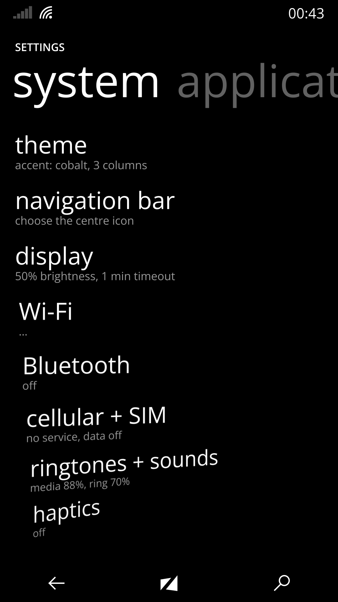
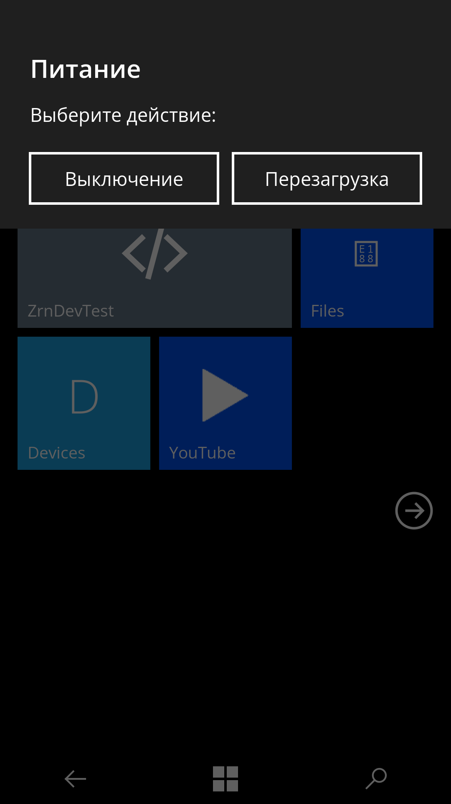
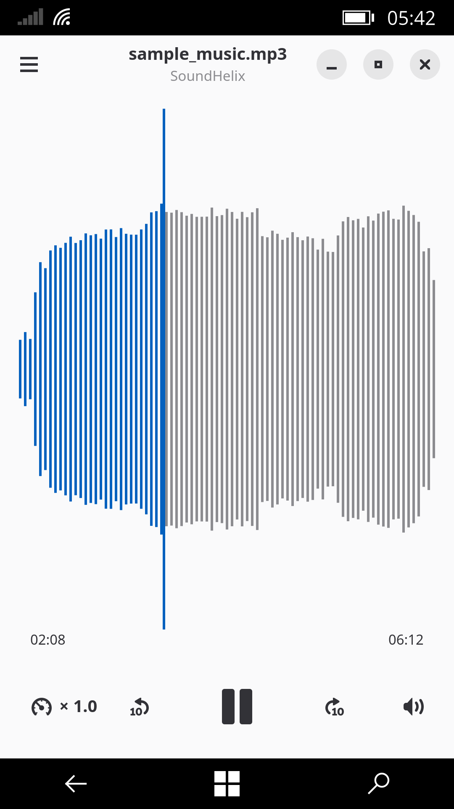

# LeEco Le 2 (s2) — postmarketOS + ztOS

**English** | [Русский](README.md)

---

A port of **postmarketOS (Alpine Linux)** to the **LeEco Le 2** smartphone (`s2`, Qualcomm MSM8976 / Snapdragon 652) powered by mainline **Linux 6.18.7**, DRM/KMS, hardware-accelerated **Adreno 510 (Freedreno)**, Wi-Fi 802.11ac, Bluetooth, SMBCHG charging, and the **ztMETRO** mobile shell from **ztOS**.

**Links:** [postmarketOS](https://postmarketos.org/) · [pmaports](https://gitlab.com/postmarketOS/pmaports) · [ztOS](https://github.com/Zerone-Laboratories/ztOS) · [zrn-sdk](https://github.com/Zerone-Laboratories/zrn-sdk)

**Status:** Working port: boots stand-alone, UI, Wi-Fi, Bluetooth (basic), and audio are operational on real hardware.  
**Last revised:** 2026-11-15.  
**Bugs & recovery:** [`docs/bug_report.md`](docs/bug_report.md) · **Changelog:** [`docs/changelog_jt.md`](docs/changelog_jt.md).

## Screenshots

<table>
<tr>
<td align="center"><br><b>Lockscreen</b></td>
<td align="center"><br><b>ztMETRO Settings</b></td>
<td align="center"><br><b>Power Menu</b></td>
</tr>
<tr>
<td align="center"><br><b>Browser & On-Screen Keyboard</b></td>
<td align="center"><br><b>Angelfish</b></td>
<td align="center"><br><b>Audio Playback</b></td>
</tr>
</table>

## Working Status

| Component | Status | Verified on Hardware |
|---|---|---|
| Bootloader & Boot | Working | lk2nd → p27, mainline Linux 6.18.7 #19, rootfs on p56 |
| Display & GPU | Working | 1080×1920 @ 60 FPS, DSI BOE NT35596s, Adreno 510 / Freedreno, GLES2 |
| Touchscreen | Working | Synaptics S2-05-01, 10-point multitouch, capacitive Menu/Home/Back keys |
| Power & Charging | Working | PMI8950 SMBCHG, up to 1.5 A, telemetry, UVLO spontaneous shutdown fixed |
| Wi-Fi | Working | WCN3680, 2.4/5 GHz, WPA2/WPA3, DHCP, `rp_filter` routing fixed |
| Bluetooth | Partially working | `hci0` and BlueZ 5.86 initialize; A2DP with real headset unverified |
| Audio | Working | ADSP/QDSP6 → Quinary MI2S → TFA9890, PipeWire, `q6asm-dai` fix (#19) |
| Volume Control | Working | ztmetro + `ztos-sounds`, media and ring volume |
| Mobile Shell | Working | ztMETRO: Start with parallax wallpapers, navbar autohide (gestures), Lock screen, Power menu, Settings, OSK |
| Applications | Working | ztapps, ztsettings, ztpower, ztfiles, YouTube PWA, Instagram PWA, Angelfish, Chromium, Terminal |
| USB RNDIS + SSH | Working | `172.16.42.1`, Windows driver & certificate included in repo |
| zram | Working | ~50% RAM, lzo-rle, priority 100 |
| Audio Capture | Not implemented | No backend for MultiMedia2: `arecord` → `EINVAL` |
| Modem / SIM | Not implemented | `qmic` / ModemManager not wired up |
| Camera | Not implemented | — |
| Suspend / CPU idle | Not implemented | No deep sleep; power management optimizations planned |

## Future Roadmap

- [ ] **UCM2 profile** for `msm8976-leeco-s2` instead of `pro-audio` workaround: standard audio ports, volume and working mic capture.
- [ ] **Cellular modem:** `qmic` / ModemManager, SIM card reading, cellular data, SMS.
- [ ] **Camera:** sensor drivers and ISP support.
- [ ] **Power management:** CPUFreq `schedutil`, CPU idle, Suspend-to-RAM, display timeout sleep.
- [ ] **Sensors:** accelerometer, gyroscope, ambient light sensor.
- [ ] **ztOS:** pin upstream commits, build ztmetro/ztos-sounds from source, submit `ztos-port/patches/ztmetro-leeco-s2.patch` upstream.
- [ ] **CI & Releases:** build `Image`, DTB, and initramfs via GitHub Actions, attach to GitHub Releases with checksums (binaries excluded from git).
- [ ] **pmaports:** package `device-leeco-s2` for upstream postmarketOS once fully stabilized.

## Documentation

| Document | Description |
|---|---|
| [`docs/bug_report.md`](docs/bug_report.md) | Log of issues BR-001…BR-035, recovery workflows, hardware tests |
| [`docs/changelog_jt.md`](docs/changelog_jt.md) | Port development changelog |
| [`docs/system_analysis.md`](docs/system_analysis.md) | Architecture audit, open tasks, and priorities |
| [`docs/power_management_analysis.md`](docs/power_management_analysis.md) | Power management notes & experiences from other MSM8976/8956 ports |

---

## 1. Goal and Achievements

Port the LeEco Le 2 smartphone from its legacy vendor Android 3.10 kernel to modern mainline Linux 6.18.7 with native **DRM/KMS**, hardware-accelerated **Freedreno (OpenGL ES 3.1)**, integrated power/charging management, wireless networking, and the **ztOS Mobile** interface (`ztmetro` + `ztapps`).

### Current Status:
- **Mainline Linux 6.18.7-msm8956+ #19:** boots stand-alone from `p27`, root filesystem on `p56` (`/dev/mmcblk0p56`). Build #19 resolves the `q6asm-dai` bug (BR-034) which previously silenced PipeWire.
- **Display & KMS:** 1080×1920 @ 60 FPS on BOE NT35596s DSI panel, scaled at UI Scale 2.0 (540×960 dp).
- **GPU:** Qualcomm Adreno 510 3D hardware accelerator (`freedreno FD510`, Mesa 26.1.6).
- **Touch Input:** Synaptics S2-05-01 controller (10-point multitouch + capacitive Menu/Home/Back keys).
- **Power & Charging:** PMI8950 SMBCHG (up to 1.5 A charging current, voltage and capacity telemetry, spontaneous UVLO shutoffs resolved).
- **Wireless Networking:** Qualcomm WCN3680 (WCNSS PIL + `wcn36xx` driver): Dual-Band Wi-Fi (2.4 GHz and 5 GHz 802.11ac), Bluetooth `hci0` via Qualcomm SMD. WCNSS starts automatically on `remoteproc1`, `wlan0` obtains IP via DHCP (`udhcpc`), `hci0` initializes automatically without manual commands. Interactive network scanning, WPA2/WPA3 connectivity, and real-time IP reporting for USB RNDIS (`172.16.42.1`) and Wi-Fi (`192.168.x.x`).
- **Audio:** Qualcomm QDSP6 / ADSP (`remoteproc0`), soundcard `msm8976leecos2`, routing `QUIN_MI2S_RX Audio Mixer MultiMedia1` → TFA9890 amplifier (GPIO 132/111). PipeWire + WirePlumber + `pipewire-pulse` run under user `pmos`; card profile is `pro-audio`, sink `pro-output-0`. Kernel #19 fixes `q6asm-dai` (BR-034): DSP session properly terminates prior to repeated `prepare` calls after STOP, preventing PCM from hanging in `SETUP`. Playback fixed to `S16_LE` (8 ch, 48 kHz). Audio verified via external microphone: 1 kHz tone, PCM `RUNNING`, `hw_ptr` advances, 0 ASM errors, consecutive streams working. Media volume adjustable via hardware keys and UI using ztmetro (`ztos-sounds`, BR-035).
- **Shell & Input:** Wayland compositor `ztmetro` (ztOS) with `ztapps`, settings in `ztsettings`, power management in `ztpower`, and system sounds in `ztos-sounds`. Alternatively, [`zrn-launcher`](https://github.com/Zerone-Laboratories/zrn-sdk/blob/main/examples/launcher/main.c) based on `libzrnui` in Windows Phone / Metro style with hardware-accelerated **EN/RU OSK** in [`libzrnui`](https://github.com/Zerone-Laboratories/zrn-sdk/blob/main/libzrnui/src/osk.c).

---

## 2. Hardware Platform

| Specification | Value |
|---|---|
| **Device** | LeEco Le 2 (`s2`, `le_s2_ww`, X527 / X526) |
| **SoC** | Qualcomm MSM8976 / Snapdragon 652 (4x Cortex-A53 1.4 GHz + 4x Cortex-A72 1.8 GHz) |
| **GPU** | Qualcomm Adreno 510 (`freedreno FD510`, GLES 3.1 Mesa 26.1.6, 60 FPS) |
| **RAM** | 3 GB LPDDR3 (CMA allocated 96 MB for DRM and GPU); zram swap ~1.4 GB (lzo-rle, priority 100) |
| **Storage** | 32 GB eMMC 5.1 (HS200 mode, 100 MHz clock) |
| **Display** | 5.5" IPS BOE NT35596s, 1080×1920, DSI video mode, backlight 0..4095 |
| **Touchscreen** | Synaptics S2-05-01 (RMI4 I2C, `/dev/input/event2`, 10 touch points) |
| **Power Controller** | Qualcomm PMI8950 (integrated SMBCHG 1.5 A charger, fuel gauge FG) |
| **Wi-Fi / BT** | Qualcomm WCN3680 (Prima): 802.11a/b/g/n/ac 2.4/5 GHz + Bluetooth 4.1 LE / A2DP |
| **Bootloader** | `lk2nd` on `mmcblk0p23`, boot menu on **p27**: `/mnt/system/extlinux/extlinux.conf`, points to `fdt /msm8976-leeco-s2.dtb` at root of p27 (copies in `/boot` on p56 are **not read** by bootloader; mount `/dev/mmcblk0p27 /mnt/system` to edit) |
| **Partitioning** | `p27` — `/boot` (ext4, 64 MB); `p56` — rootfs postmarketOS (ext4, ~24 GB) |
| **Network Access** | USB RNDIS (`172.16.42.1/24`, SSH port 22), Wi-Fi (`wlan0` via WPA Supplicant) |
| **Recovery Fallback** | Power + Vol Up → TWRP recovery; fallback entry `s2` (legacy 3.10 kernel) in lk2nd |

---

## 3. Architecture & Subsystems

### 3.1 Kernel & Drivers (Linux 6.18.7-msm8956+ #19)
- **DRM/KMS:** enabled `CONFIG_DRM_MSM=y`, `CONFIG_DRM_MSM_MDP5=y`, `CONFIG_DRM_MSM_DSI=y`, `CONFIG_DRM_MSM_DSI_28NM_PHY=y`, built-in panel driver `panel-leeco-s2-boe-nt35596s.c`. Device `/dev/dri/card0` active, `card0-DSI-1/status = connected`.
- **GPU Adreno 510:** nodes `&adreno_gpu` and `&gpu_iommu` enabled in Device Tree [`msm8976-leeco-s2.dts`](kernel/msm8976-leeco-s2.dts). Firmware blobs `a530_pm4.fw` and `a530_pfp.fw` installed. 96 MB CMA pool assigned (`cma=96M` in cmdline). Wayland and applications render via hardware GLES2 smoothly.
- **eMMC Controller:** fixed hardware interrupt lockups under intensive I/O (BR-013). DTS pins switched to `sdc1_default` (16 mA), max frequency capped at 100 MHz (`max-frequency = <100000000>`).
- **Swap (zram):** [`zram.start`](configs/openrc/zram.start) in `/etc/local.d` allocates `/dev/zram0` to ~50% RAM (lzo-rle, priority 100) and enables swap; zero eMMC wear.
- **Touch Input:** Synaptics RMI4 I2C controller supported via `CONFIG_INPUT_EVDEV=y`. Node `/dev/input/event2` provides 10-point multitouch and bottom capacitive keys in `libinput` and `ztmetro` (or `cage` in alternate mode).
- **PMI8950 Charging Controller (BR-014):**
  - Driver `CONFIG_CHARGER_QCOM_SMBCHG=y` built into kernel.
  - DTS enables `&pmi8950_smbcharger` and `&pmi8950_fg`, with `simple-battery` profile (3000 mAh, 3.4..4.4 V, 1.5 A charge limit).
  - [`configs/openrc/start-sshd.sh`](configs/openrc/start-sshd.sh) sets charge current limit: `echo 1500000 > /sys/class/power_supply/qcom-smbchg-usb/input_current_limit`.
  - Spontaneous Under-Voltage Lockout (UVLO) shutdowns resolved.
- **Wi-Fi & Bluetooth (BR-015):**
  - Built-in drivers: `CONFIG_QCOM_WCNSS_PIL=y`, `CONFIG_QCOM_WCNSS_CTRL=y`, `CONFIG_WCN36XX=y`, `CONFIG_CFG80211=y`, `CONFIG_MAC80211=y`, `CONFIG_RFKILL=y`, `CONFIG_BT=y`, `CONFIG_BT_QCOMSMD=y`.
  - DTS nodes `&wcnss` and `&wcnss_iris` (`compatible = "qcom,wcn3680"`).
  - Firmware files `wcnss.mdt`, `wcnss.b00`..`b12` extracted from stock modem partition.
  - Authentic calibration file `WCNSS_qcom_wlan_nv.bin` (`0xCAFEBABE`, 31,723 B) and configs `WCNSS_qcom_cfg.ini`, `WCNSS_cfg.dat` loaded.
  - `wlan0` interface active: scans 2.4 GHz and 5 GHz (802.11ac) networks, Bluetooth `hci0` ready.
  - **Wi-Fi Data Routing (BR-030):** With two uplinks (Wi-Fi + USB RNDIS), strict `rp_filter` dropped incoming `wlan0` packets when reverse route pointed to `usb0`. [`configs/openrc/start-sshd.sh`](configs/openrc/start-sshd.sh) configures loose mode `rp_filter = 2` across `all`, `default`, and interfaces on start and watchdog; USB default route assigned fallback `metric 700` (Wi-Fi DHCP — `metric 303`). Throughput: ~5.4–6.3 MB/s on 5 GHz.
  - **Permissions & Auto-bringup:**
    - Socket `/var/run/wpa_supplicant` granted `wheel` group (`ctrl_interface_group=wheel`), allowing unprivileged `pmos` user to run `wpa_cli` scans without `Permission denied`.
    - User `pmos` granted passwordless `sudo` rights for `/usr/local/bin/wifi-connect` to configure interfaces and run `udhcpc`.
    - [`configs/openrc/start-sshd.sh`](configs/openrc/start-sshd.sh) boots **all** offline remoteprocs (ADSP & WCNSS); once `wlan0` is online, `wpa_supplicant` starts, followed by `udhcpc` upon `wpa_state=COMPLETED`. Background watchdog maintains lease and audio route.
    - Bluetooth `hci0` initializes automatically after WCNSS starts; `rfkill` unblocks, BlueZ 5.86 `bluetoothd` binds the adapter.
- **Audio (BR-023, BR-024, BR-026):**
  - ADSP (`remoteproc0`) boots from `/lib/firmware/qcom/msm8976/adsp.*`; ALSA card — `card 0: msm8976leecos2`.
  - Speaker routing enabled via `QUIN_MI2S_RX Audio Mixer MultiMedia1`; amplifier on GPIO 132 controlled by kernel (`simple-amplifier`, consumer `enable`).
  - [`configs/system/asound.conf`](configs/system/asound.conf) configures `card 0` as default for `amixer`/`aplay`.
  - PipeWire session (`dbus-daemon --session`, `pipewire`, `wireplumber`, `pipewire-pulse`) launched from `configs/openrc/start-sshd.sh` as user `pmos` (`audio` group member).
  - Default card profile `off`; WirePlumber rule `51-msm8976.conf` selects `pro-audio`, sink `alsa_output.platform-c051000.sound.pro-output-0`.
  - **Volume Management (BR-035):** ztmetro adjusts media volume via `wpctl set-volume @DEFAULT_AUDIO_SINK@` only while `ztos-sounds` reports `audio-active`. Built from `/root/ztos-ztmetro/sounds`, installed to `/usr/local/bin`, and auto-spawned by ztmetro. Hardware keys control sink volume during active streams, and ring volume when idle (matching Windows Phone behavior).
  - **Audio Reliability (BR-031, BR-034):** In WirePlumber configuration ([`configs/system/wireplumber.conf`](configs/system/wireplumber.conf), alias `51-msm8976.conf` on device), non-working nodes `pro-output-2` and `pro-input-1` are disabled, and `pro-output-0` priority raised. Watchdog in [`configs/openrc/start-sshd.sh`](configs/openrc/start-sshd.sh) (~60 s cycle) detects ASM failures and recovers ADSP. Root cause resolved in kernel #19: `q6asm_dai_prepare()` now cleanly terminates existing ASM sessions when `state != IDLE` (post-`TRIGGER_STOP` `STOPPED`), preventing `EALREADY` errors and pointer nullification. Playback restricted to `S16_LE`. Verified via microphone: consecutive `pw-play` streams, PCM `RUNNING`, 1000 Hz tone, 0 ASM errors.

---

### 3.2 Graphical Environment & OpenRC
- **OpenRC Services:** `seatd` and `wayland` services enabled in `default` runlevel.
- **Clock Skew Remediation:** [`configs/openrc/start-sshd.sh`](configs/openrc/start-sshd.sh) verifies system clock; if RTC defaults to 1970, date is synchronized and stale cache `/var/cache/rc/deptree` flushed. Service [`configs/openrc/clock.start`](configs/openrc/clock.start) updates time via NTP in background (fallback: HTTP `Date`), ensuring TLS certificates validate properly.
- **Compositor:** `ztmetro` (ztOS) launched under `pmos` with GLES2 hardware rendering, hosting `ztapps`, `ztsettings`, `ztpower`, and `ztos-sounds`. Compositor configurable via `COMPOSITOR` in `/etc/conf.d/wayland` (`ztmetro`, `labwc`, `cage`, `weston`).
- **Session Bus & Sound:** [`configs/openrc/start-sshd.sh`](configs/openrc/start-sshd.sh) creates `/run/user/1000`, starts user `dbus-daemon`, PipeWire, WirePlumber, and `pipewire-pulse`; [`configs/openrc/wayland.init`](configs/openrc/wayland.init) exports `DBUS_SESSION_BUS_ADDRESS=unix:path=/run/user/1000/bus`.
- **Session Script (`cage` mode):** [`/usr/local/bin/zrn-session`](scripts/zrn-session) configures UI Scale 2.0 (`wlr-randr --output DSI-1 --scale 2.0`) and supervises mobile launcher loops.

---

### 3.3 Alternative Launcher: zrn-launcher (zrn-sdk)

> By default, the device runs `COMPOSITOR="ztmetro"` (ztOS: `ztapps`, `ztsettings`, `ztpower`, `ztos-sounds`). This section describes the alternative launcher `zrn-launcher` built with `libzrnui`.

The application [`zrn-sdk/examples/launcher/main.c`](https://github.com/Zerone-Laboratories/zrn-sdk/blob/main/examples/launcher/main.c) is built on **libzrnui** using the Windows Phone / Metro UI concept:
- **Applications Tab:**
  - System settings (screen brightness, dark/light theme, accent color selector).
  - Embedded Terminal / Console (interactive UI shell with quick buttons `free`, `ip a`, `uptime`, `dmesg`).
  - Mobile Foot Terminal (CLI session under Wayland).
  - Python 3.14 / zrnui demo app.
  - Interactive widgets demo (tap counters, text fields with OSK).
  - System resource monitor and quick brightness slider.
- **Device Tab:**
  - Hardware platform specs (MSM8976, Adreno 510, Linux 6.18.7, Alpine 3.24).
  - Power status: battery level, live cell voltage, net charge/discharge current, PMI8950.
  - Network connections: dynamic Wi-Fi status (`SSID` & IP), USB RNDIS (`172.16.42.1 (SSH)`), and Bluetooth (`hci0`).
  - Safe reboot action button.
- **Wi-Fi Subpage:**
  - Real-time MAC, state (`COMPLETED`, `INACTIVE`), and IP addresses (Wi-Fi DHCP and USB RNDIS).
  - Active scan button (polls 2.4/5 GHz channels).
  - Discovered networks list with signal strength (dBm) and frequency bands.
  - One-tap connect with password input via on-screen keyboard.
  - DHCP address assignment (`udhcpc`).
- **On-Screen Keyboard (libzrnui OSK, BR-016):**
  - Full layouts: English (QWERTY), Russian (ЙЦУКЕН), Numbers & symbols (?123 / ABC).
  - One-tap layout toggle (`EN` / `RU`, `?123` / `ABC`).
  - Punctuation quickbar (`, . ! ? - @ : / _`) and collapse button `[✕]`.
  - Automatic invocation on text field focus with auto-scroll lifting.
  - 60 FPS hardware GLES2 rendering.
- **Lockscreen & Sleep Mode (BR-017):**
  - **Lockscreen:** large Metro digital clock, date, status badges (battery, voltage, active network), `🔓 Unlock` and `🌙 Sleep` buttons.
  - **Back Key Guard:** hardware/capacitive back button suppressed while locked.
  - **Display Sleep:**
    - Backlight turned off (`brightness = 0`).
    - CPU governor switched to `powersave` (400 MHz).
    - GLES2 render loop suspended (0% GPU/CPU load).
    - OSK collapsed automatically.
  - **Wake & Lock Triggers:**
    - Physical Power button: `/dev/input/event0` (`pm8941_pwrkey`) toggles sleep/wake.
    - Tap-to-wake: tapping `/dev/input/event2` restores display to lockscreen.
    - Inactivity timer: automatic sleep after 60 seconds without touch input.
    - UI button: `🔒 Lock screen` on Apps tab.
    - Signals (`signalfd`): `SIGHUP` (power key), `SIGUSR1` (lock/sleep), `SIGUSR2` (wake/unlock).
- **Volume Controls (BR-018):**
  - **Hardware volume buttons:**
    - **Volume Down** (`KEY_VOLUMEDOWN` 114): `/dev/input/event1` (`pm8941_resin`), step -5%.
    - **Volume Up** (`KEY_VOLUMEUP` 115): `/dev/input/event3` (`gpio-keys`), step +5%.
    - Key repeat supported (`ev.value == 2`) for smooth adjustment.
    - Wayland keyboard listener with 30 ms debouncing.
  - **On-Screen Toast HUD:**
    - Pop-up toast displaying dynamic icon: `🔇 Mute`, `🔈 15%`, `🔉 45%`, `🔊 75%`, `🔊 100% (max)`.
    - Haptic vibration feedback (`haptic tap`).
  - **UI Controls:**
    - Quick slider and volume buttons on main Apps tab.
    - Detailed Audio section in Settings with mute toggle and presets (`25%`, `50%`, `75%`, `100%`).
  - **Integration & State:**
    - Dispatches volume updates to `amixer`, `wpctl` (PipeWire), and `pactl` (PulseAudio).
    - Persists volume state to `~/.config/zrn-volume` across reboots.
    - Control FIFO `/tmp/zrn-ctl` for scripts and SSH (`vol +5`, `vol -5`, `vol <0-100>`, `mute`, `page <name>`).
- **Chromium Web Browser & PipeWire (Web & Audio, BR-019):**
  - **Browser:** `chromium` (156.0.8078.79) with Noto, DejaVu, and OpenSans font packages.
  - **Native Wayland:** launched with `--ozone-platform=wayland`, `--force-device-scale-factor=2.0`, and `--start-maximized`.
  - **Hardware 3D Acceleration:** Adreno 510 GPU rendering via EGL/GLES2.
  - **PipeWire 1.6.8 Audio:** automatic PipeWire daemon, WirePlumber, and `pipewire-pulse` bridge startup.
  - **Audio Streaming:** Chromium → PipeWire verified: sink `pro-output-0` (`pro-audio` profile), PCM `RUNNING`, `hw_ptr` advances, no underruns; volume synchronized with launcher (`wpctl`). External microphone confirms 1 kHz audio output following the `q6asm-dai` fix in kernel #19 (BR-034).
  - **YouTube & Instagram PWA (Standalone Ad-Free Web Apps):**
    - **YouTube:** runner [`scripts/launch-youtube`](scripts/launch-youtube) launches `https://m.youtube.com` in an isolated profile (`~/.config/youtube-app`) in full-screen touch mode (`--app`) with preloaded uBlock Origin, Adreno 510 GPU acceleration, and a two-column grid (`YT_SCALE=0.5`).
    - **Instagram:** runner [`scripts/launch-instagram`](scripts/launch-instagram) launches `https://www.instagram.com` in an isolated profile (`~/.config/instagram-app`) with preloaded uBlock Origin, native 1:1 mobile density (`INSTA_SCALE=1.0`), and a dedicated magenta Start tile.
    - **Integration:** registered desktop shortcuts [`configs/system/youtube.desktop`](configs/system/youtube.desktop) and [`configs/system/instagram.desktop`](configs/system/instagram.desktop), with [`configs/system/chromium.conf`](configs/system/chromium.conf) sanitized of conflicting global scales.
- **Start & Lock Screen Wallpapers (ztMETRO Wallpapers):**
  - Native Windows Phone 8.1 / 10 Mobile tile transparency with parallax background image scrolling on Start (`start_wallpaper`) and dedicated background under the lock screen clock (`lock_wallpaper`).
  - Helper utility [`scripts/set-wallpaper`](scripts/set-wallpaper) applies wallpapers on the fly without restarting the shell: `set-wallpaper <path_to_image>`. When called without arguments, it automatically finds and applies the most recent downloaded image in `~/Downloads`.
  - Installed official `postmarketos-artwork-wallpapers` package, user wallpaper repository: `~/Pictures/Wallpapers/`.
  - Full configuration stored in [`configs/ztmetro/config`](configs/ztmetro/config) and [`configs/ztmetro/tiles`](configs/ztmetro/tiles).
- **Navigation Bar Auto-hide (ztMETRO Navigation Bar Autohide):**
  - Native auto-hiding navigation bar mode (`nav_bar = autohide`) freeing the entire display height for running apps (YouTube, Instagram, browser) and Start/Lock screen wallpapers.
  - **Gesture Controls:** swipe up from the bottom screen edge (or tap the bottom bezel) smoothly reveals the navigation bar with Back, Start, and Search; swipe down on the bar immediately dismisses it; after 3.5 seconds of inactivity (or upon tapping a navigation action) the bar smoothly slides away automatically.
  - **Process Supervision:** child processes detached using `setsid()`, leaked file descriptors closed (`fd >= 3`), zombies reaped via `signal(SIGCHLD, SIG_IGN)`. Focus instantly reverts to `zrn-launcher` on browser exit.

---

## 4. Bootloader Configuration (`extlinux.conf`)

The source bootloader menu configuration is located at [`configs/boot/extlinux.conf`](configs/boot/extlinux.conf) and deployed to partition `p27` (`/boot/extlinux/extlinux.conf`):

```text
timeout 10
default mainline

label mainline
    menu label postmarketOS Mainline (Linux 6.18.7 + Freedreno GPU + Wi-Fi)
    kernel /Image
    fdt /msm8976-leeco-s2.dtb
    initrd /initramfs-tiny.switch
    append console=ttyMSM0,115200n8 earlycon=msm_serial,0x78b0000 clk_ignore_unused consoleblank=0 loglevel=8 cma=96M pstore.backend=ramoops pmos_root=/dev/mmcblk0p56

label s2
    menu label postmarketOS Legacy 3.10 (Fallback X11/fbdev)
    kernel /vmlinuz
    fdt /s2.dtb
    initrd /initramfs-tiny.switch
    append earlyprintk clk_ignore_unused consoleblank=0 loglevel=8 pstore.backend=ramoops
```

---

## 5. Windows USB RNDIS Driver

To access the device shell over USB from Windows, a signed test RNDIS driver is provided in [`tools/windows-rndis/`](tools/windows-rndis/):

| File | Description |
|---|---|
| [`tools/windows-rndis/windows_rndis_s2.inf`](tools/windows-rndis/windows_rndis_s2.inf) | Driver INF configuration (`CatalogFile=windows_rndis_s2.cat`) |
| [`tools/windows-rndis/windows_rndis_s2.cat`](tools/windows-rndis/windows_rndis_s2.cat) | Signed security catalog (SHA-256) |
| [`tools/windows-rndis/windows_rndis_s2.cer`](tools/windows-rndis/windows_rndis_s2.cer) | Public test certificate |
| [`tools/windows-rndis/windows_rndis_s2.cdf`](tools/windows-rndis/windows_rndis_s2.cdf) | Catalog definition file for `makecat` |

### Installation on a new Windows host (Administrator PowerShell):
```powershell
Import-Certificate .\tools\windows-rndis\windows_rndis_s2.cer -CertStoreLocation Cert:\LocalMachine\Root
Import-Certificate .\tools\windows-rndis\windows_rndis_s2.cer -CertStoreLocation Cert:\LocalMachine\TrustedPublisher
pnputil /add-driver .\tools\windows-rndis\windows_rndis_s2.inf /install
```

### Host IP Configuration & SSH Connection:
```powershell
# Set static IP on host RNDIS interface
New-NetIPAddress -InterfaceAlias 'Ethernet 5' -IPAddress 172.16.42.2 -PrefixLength 24

# SSH into device
ssh -i "$HOME\.ssh\id_rsa" -o StrictHostKeyChecking=no root@172.16.42.1
```

---

## 6. CLI Utilities & System Controls

Command-line utilities installed on the device for fast network, media, and interface management:

### Wallpaper Management (Start & Lock Screen):
```sh
# Automatically find and apply the most recent image from ~/Downloads
set-wallpaper

# Apply a specific image to both Start and Lock screen
set-wallpaper ~/Downloads/my_wallpaper.jpg

# Apply only to Start screen tiles (parallax) or only Lock screen
set-wallpaper --start ~/Pictures/Wallpapers/postmarketos_dark.png
set-wallpaper --lock ~/Pictures/Wallpapers/lock.jpg

# Revert to clean solid accent color without photo
set-wallpaper --clear
```

### Navigation Bar Configuration (ztMETRO Navbar):
The navigation bar mode is set in `~/.config/ztmetro/config`:
```ini
nav_bar = autohide   # autohide (gesture-driven), on (always visible), off (disabled)
```
- **Swipe up from bottom edge** (or tap near the bottom bezel) — smoothly reveals the navigation bar with Back, Start, and Search buttons.
- **Swipe down on open bar** — immediately dismisses the navigation bar.
- **3.5s Inactivity Timeout** — automatically slides away when no touches are detected.
- **Tap into app area** — tapping anywhere in an application above the bar immediately hides the bar and forwards the touch to the app.
- Reload on the fly after editing config: `killall -HUP ztmetro` or restart the Wayland session.

### Scan available networks:
```sh
wifi-scan
```
Lists SSID, frequency (2412 / 5180 MHz), signal level (dBm), and security (WPA2/WPA3).

### Connect to a Wi-Fi network:
```sh
wifi-connect "Network_Name" "Password"
```
Configures WPA Supplicant, establishes connection, and triggers DHCP lease (`udhcpc`).

---

## 7. Repository Layout & Artifacts

### Tracked in Git

| Path | Purpose |
|---|---|
| `README.md`, `README_en.md`, `LICENSE` | Documentation and project license |
| `configs/` | System configurations: bootloader (`boot/`), OpenRC services (`openrc/`), system settings (`system/`), ztMETRO shell (`ztmetro/config`, `ztmetro/tiles`) |
| `docs/` | Bug reports, changelog, audit notes, screenshots |
| `kernel/` | Kernel & bootloader (`lk2nd`) patches, `.config`, DTS, NT35596s panel driver, `build.sh` |
| `scripts/` | Deployment scripts (`deploy/`), PWA launchers (`launch-youtube`, `launch-instagram`), wallpaper tool (`set-wallpaper`), network utilities, key daemon |
| `tests/` | Acoustic testing and hardware audio verification scripts |
| `tools/` | Windows RNDIS driver (`windows-rndis/`), initramfs builder (`initramfs/`), panel generator, DTB builder |
| `firmware-s2/` | WCNSS calibration files (`.bin`, `.ini`, `.dat`) |
| `tiny_initramfs*/` | `init`, `init.switch`, manifests, busybox, and adbd for recovery and dual-boot |
| `ztos-port/` | ztMETRO setup scripts, `nmcli` wrapper, tiles, configs, and patch `ztmetro-leeco-s2.patch` |

Binary kernel images (`Image`, `Image.gz`), DTBs, `initramfs-*`, `*.img`, `*.wav`, logs, and temporary plots are excluded via `.gitignore` and distributed via GitHub Releases.

### External Repositories

| Repository | Version | Purpose |
|---|---|---|
| [postmarketOS](https://postmarketos.org/) | Alpine 3.24 | Rootfs and userspace base |
| [pmaports](https://gitlab.com/postmarketOS/pmaports) | main | Upstream device packages and kernel configs |
| [ztOS](https://github.com/Zerone-Laboratories/ztOS) | `b3bff47` | ztMETRO, ztapps, ztsettings, ztos-sounds |
| [zrn-sdk](https://github.com/Zerone-Laboratories/zrn-sdk) | `f0b4ba3` | `libzrnui` and alternative launcher |

`ztOS/` and `zrn-sdk/` directories are upstream repositories excluded from this git tree. LeEco Le 2 port modifications are tracked in [`ztos-port/patches/ztmetro-leeco-s2.patch`](ztos-port/patches/ztmetro-leeco-s2.patch).

### Build Artifact Reference (2026-11-15)

| Artifact | Size (bytes) | MD5 | Origin |
|---|---:|---|---|
| `Image` (mainline #19) | 30,992,896 | `4A118193D61FBF308E217CEDEC06DFB7` | `kernel/build.sh` / Releases |
| `Image.gz` (mainline #19) | 11,165,797 | `AF346E8195BDF2CD395C912136B63B25` | `kernel/build.sh` / Releases |
| `msm8976-leeco-s2.dtb` | 48,453 | `EE58153D389DF343721881B6F4E4AFF8` | `kernel/build.sh` / Releases |
| `initramfs-tiny.switch` | 1,349,500 | `E9FFB095ED5F32C5CCD2377CB195F77D` | `tools/initramfs/build_initramfs.py` / Releases |
| `firmware-s2/WCNSS_qcom_wlan_nv.bin` | 31,723 | `A2D9D2D9ACCA2C2E1D2D5B7600E4A105` | Tracked in git |
| `vmlinuz` (legacy 3.10) | 8,911,188 | `D17B88CFBE011C0110EA57916AD1203C` | Fallback, excluded from git |
| `s2.dtb` (legacy 3.10) | 278,801 | `D253FF3846C0D5B58E6BDF15F66C2A17` | Fallback, excluded from git |

---

## 8. Build & Deployment

### 8.1 Linux Kernel

```sh
git clone --depth=1 --branch v6.18.7 \
  https://git.kernel.org/pub/scm/linux/kernel/git/stable/linux.git \
  "$HOME/linux-msm8956"
KERNEL_DIR="$HOME/linux-msm8956" JOBS="$(nproc)" ./kernel/build.sh

ART="$HOME/linux-msm8956/arch/arm64/boot"
cp "$ART/Image" "$ART/Image.gz" "$ART/dts/qcom/msm8976-leeco-s2.dtb" .
```

`build.sh` applies `kernel/leeco-s2-6.18.7.patch`, copies config/DTS/panel driver, and builds `Image`, `Image.gz`, and DTB. The patch includes playback format restriction to `S16_LE` and the `q6asm-dai` fix (BR-034).

### 8.2 initramfs

```sh
python3 tools/initramfs/build_initramfs.py tools/initramfs/tiny_manifest.txt initramfs-tiny.cpio tiny_initramfs
python3 tools/initramfs/build_initramfs.py tools/initramfs/tiny_manifest.switch.txt initramfs-tiny.switch tiny_initramfs_switch
```

`tiny_initramfs*/bin/busybox` and `tiny_initramfs_switch/sbin/adbd` are tracked in git. When replacing, use statically built busybox and arm64-adbd binaries.

### 8.3 Kernel Deployment (Windows → SSH)

```powershell
$KEY = "$HOME\.ssh\id_rsa"
scp -i $KEY Image msm8976-leeco-s2.dtb initramfs-tiny.switch root@172.16.42.1:/tmp/
ssh -i $KEY root@172.16.42.1 "mount /dev/mmcblk0p27 /mnt/system; cp /tmp/Image /mnt/system/Image; cp /tmp/msm8976-leeco-s2.dtb /mnt/system/; cp /tmp/initramfs-tiny.switch /mnt/system/; cp /tmp/Image /Image; cp /tmp/msm8976-leeco-s2.dtb /; sync; md5sum /mnt/system/Image /Image; umount /mnt/system; reboot"
```

Provide your own SSH key (`id_rsa` is ignored). `lk2nd` reads `Image` and DTB from the **root of p27** (`configs/boot/extlinux.conf`: `kernel /Image`, `fdt /msm8976-leeco-s2.dtb`).

### 8.4 Rootfs, ztMETRO & Alternative Launcher

`scripts/deploy/deploy_live.sh` (executed on device from `$D`) installs `start-sshd.sh`, `asound.conf`, `speaker.start`, WirePlumber rules, and registers `local`/`bluetooth` into runlevel `default`. Detailed instructions are available in [`docs/bug_report.md`](docs/bug_report.md), Section 3.4.

To build ztMETRO on the device:

```sh
git clone https://github.com/Zerone-Laboratories/ztOS /root/ztos-ztmetro
git -C /root/ztos-ztmetro checkout b3bff47
git -C /root/ztos-ztmetro apply /root/postmarketos/ztos-port/patches/ztmetro-leeco-s2.patch
# Build ztmetro, ztapps, ztsettings, ztos-sounds following upstream README
SRC=/root/ztos-ztmetro sh /root/postmarketos/ztos-port/install-ztmetro.sh
```

To build alternative launcher `zrn-launcher`:

```sh
git clone https://github.com/Zerone-Laboratories/zrn-sdk
cd zrn-sdk && git checkout f0b4ba3
# On device:
cd /home/pmos/zrn-sdk/examples/launcher
gcc -O2 -I../../libzrnui/include main.c -L../../libzrnui -lzrnui -lm -o zrn-launcher
rc-service wayland restart
```

---

## 9. Licenses & Third-Party Code

| Component | License |
|---|---|
| Original port scripts, configs, and documentation | GPL-3.0-or-later (`LICENSE`) |
| `kernel/leeco-s2-6.18.7.patch`, DTS, and panel driver | GPL-2.0-only |
| ztOS (ztMETRO, ztapps, ztsettings, ztos-sounds) | GPL-3.0-or-later |
| zrn-sdk | LGPL-2.1-or-later (`libzrnui`), GPL-2.0-or-later (tools), MIT (examples) |
| `firmware-s2/` | Device calibration blobs extracted from hardware; not covered by project license |

Individual files containing their own SPDX identifier or license headers follow their respective declared terms.
